# Vigil Factory

The software factory the Vigil team uses to build [Vigil](https://github.com/Vigil-SOC/vigil).

An open-source project gets more feedback than its maintainers can act on, and the
gap widens as the project grows. Vigil Factory is how we keep up with it: agents
groom every issue, build what is worth building, and review every pull request the
community opens. It is opinionated about how they do that. The main opinion is that a
change is proven by running it, so an agent starts the app and exercises its change
through the real entry point before calling the work done, and does not lean on
review alone.

The engine works with any GitHub repository. What makes this copy Vigil's is two
files: `factory.config.json`, which points it at `Vigil-SOC/vigil`, and
`principles.md`, which says what Vigil is and what is worth building for it.

<p align="center"></p>

## What it does

- **Grooms the backlog.** Each issue is judged against `principles.md` before
  anything is built. The verdict is a label plus a signed comment on the issue. Edit
  the issue or reply to it and it is judged again.
- **Builds groomed issues.** A fresh coding agent (a Cursor cloud agent or a local
  Claude Code session) takes the issue, runs the tests that cover its change, tests the
  change live, and opens a PR that lists what it verified and what it did not. When CI
  fails, the failing checks go back to the same agent to fix.
- **Finishes outside PRs.** A contributor's PR is reviewed against the same
  principles, verified the same way, fixed on its own branch, and then merged or closed
  with a reason.
- **Keeps the repo healthy.** Further agents batch Dependabot updates, fix security
  alerts, and repair the sandbox when an agent could not run a check it needed. An
  optional agent opens PRs that only remove code.
- **Leaves the throttle with people.** A person merges what the factory builds, and
  one number (`maxConcurrentJobs`) sets how much work can be in flight at once.

State lives on GitHub in labels and comments. The factory keeps no database.

## Running it

```bash
npm install
cp .env.example .env    # CURSOR_API_KEY, or nothing for the claude-code worker
gh auth status          # needs repo scope on the target repo
npm run factory -- run --dry-run   # show what a tick would do, launch nothing
npm run factory -- run             # one tick
```

To point it at your own project, start from `factory.config.example.json` and
`principles.example.md`.

## Learn more

[docs/how-it-works.md](docs/how-it-works.md) covers every phase, label, and setting,
along with the reasons behind each one.

Before you run it on a repository that takes contributions from people you do not
know, read the [threat model](docs/threat-model.md): the agents run with write access
and skip their permission prompts. To report a vulnerability, see
[SECURITY.md](SECURITY.md).

## License

[Apache 2.0](LICENSE)
